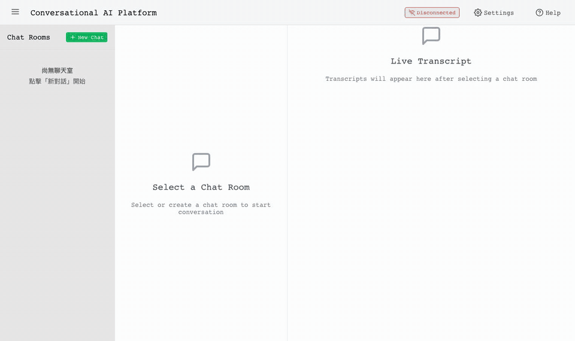

# Realtime Voice Customer-Service Agent

A browser prototype of a voice customer-service agent, built during my GenAI internship at Cathay Life Insurance (Jul.–Dec. 2025).
One React + TypeScript interface runs on top of two realtime speech APIs — **Google Gemini Live** and **Azure OpenAI Realtime** — plus a speech-to-text → LLM → text-to-speech fallback.

**Try the demo:** https://power7414.github.io/realtime-voice-agent/ (offline demo mode — no AI model is called)

[English](README.md) | [繁體中文](README_zh.md)



*Sample call in the offline demo mode (scripted conversation, shown in English; the system used in the internship served Mandarin-speaking customers). The internal business prompt, intent codes and real conversations from the internship are not part of this repository.*

## What it does
- **Three conversation modes behind one UI**: Gemini Live, Azure OpenAI Realtime, and STT → chat model → TTS. A mode is chosen per chat room.
- **Streaming audio both ways**: microphone capture and playback run in AudioWorklets (`src/audio/`), with a volume meter driving the voice animation.
- **Interruptions**: when the model reports that the user has started speaking, queued playback is stopped (`src/audio/streamer.ts`, `src/hooks/use-live-api.ts`).
- **Live transcripts and chat rooms**: each room keeps its own transcript, stored in the browser (localStorage, `src/storage/`) and exportable as text.
- **Configurable persona**: system prompt and tone are set in the settings panel (Zustand store), so prompts can be iterated without rebuilding.
- **Offline demo mode**: with no API keys (or `REACT_APP_USE_MOCK=true`) the Azure Realtime and STT-TTS modes use mock clients (`src/api/mock-*.ts`) that play a scripted conversation, so the UI can be tried at zero cost.

## Code map
```text
src/
├── api/         Gemini Live and Azure Realtime WebSocket clients, chat/STT/TTS clients, mock clients
├── audio/       recorder, streamer, AudioWorklets (audio processing, volume meter)
├── hooks/       use-live-api, use-azure-realtime, use-stt-conversation, use-conversation-controller, …
├── stores/      Zustand stores (chat rooms, settings)
├── storage/     browser persistence (localStorage)
└── components/  layout, chat sidebar, transcript panel, settings and mode picker
```

## Run it
```bash
npm install
cp .env.example .env      # optional: leave empty for the offline demo
npm start                 # or: npm run start-https  (microphone access is easier over HTTPS)
```
Open http://localhost:3000, click **New Chat**, pick a mode, then press the connect button.

> Create React App embeds `REACT_APP_*` values in the built JavaScript. Use real keys only for local runs; do not publish a build that contains them.

## Demo build
```bash
npm run build:demo   # offline demo for GitHub Pages: mock clients only, served under /realtime-voice-agent
```

## Tests
```bash
npm test          # 8 suites, 25 tests
npm run build
```

## Credits and what I built
This prototype starts from Google's [Live API Web Console](https://github.com/google-gemini/live-api-web-console) example (Apache 2.0). The Gemini Live client, the audio recorder/streamer and the AudioWorklets come from that example and keep Google's copyright headers; see [NOTICE](NOTICE).

What I added on top of it:
- **Azure OpenAI Realtime support** behind the same interface (`src/api/azure-realtime.ts`, `src/hooks/use-azure-realtime.ts`), so one UI can switch between Gemini Live and Azure.
- **STT → LLM → TTS fallback mode** (`src/api/gemini-stt.ts`, `gemini-tts.ts`, `azure-chat.ts`, `src/audio/processor.ts`, `tts-player.ts`, `src/hooks/use-stt-conversation.ts`).
- **One controller for all three modes** (`src/hooks/use-conversation-controller.ts`, `use-conversation-events.ts`).
- **Chat rooms, saved transcripts and export** (`src/stores/`, `src/storage/`, `src/hooks/use-chat-manager.ts`, sidebar and transcript panel).
- **Settings, persona and mode picker UI**, the **offline demo mode** (`src/api/mock-*.ts`, `demo-script.ts`) and the 25 unit tests.

During the internship the prototype was also connected to internal service APIs for intent recognition and routing; those integrations are not included here.

## License
Apache License 2.0; see [LICENSE](LICENSE) and [NOTICE](NOTICE).
