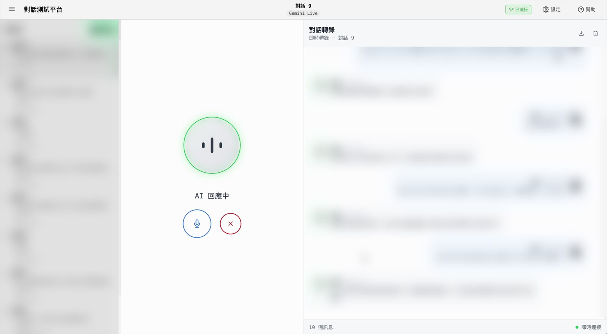

# Multimodal Realtime Voice Assistant Platform

<p align="center">
  <b>Enterprise Multimodal Voice Assistant Prototype</b><br>
  <i>Cathay Life Insurance GenAI Data Science Internship</i>
</p>

<p align="center">
  <a href="README.md"><b>English</b></a> | <a href="README_zh.md"><b>繁體中文</b></a>
</p>

<p align="center">
  
  
  
  
  
  
</p>

---

A high-performance, browser-based **multimodal realtime conversational platform** built with **React 18** and **TypeScript**. Designed with a **Unified Realtime API Architecture**, the system seamlessly bridges **Google Gemini Live API** (ultra-low latency bidirectional audio streaming) and **Azure OpenAI Realtime API**, enabling natural, low-latency voice interactions with intelligent domain intent routing.

---

## 🎬 Live Demo Showcase


* **Business Scenario**: Simulates an insurance AI customer-service representative handling a premium deduction failure, conducting multi-turn intent resolution, clarifying credit card replacement status, and dynamically dispatching online self-service SMS links.
* **Demo recording**: available on request (internal conversation content is not published).
* **Application Overview**:

<p align="center">
  
</p>

---

## 🎯 Key Architectural Highlights

### 1. Unified Realtime API Architecture (`useUnifiedRealtime`)
* **Vendor-Agnostic Audio Streaming**: Abstracted WebSocket communication protocols into a single client interface, allowing instant switching between **Google Gemini Live API** (sub-100ms bidirectional audio streaming) and **Azure OpenAI Realtime API** (enterprise stability).
* **Robust Session State Machine**: Handles auto-reconnects, session resumption, and real-time **barge-in interruption detection**.

### 2. Low-Latency Web Audio Pipeline (AudioWorklet & Streamer)
* **Custom AudioStreamer Engine**: Eliminates browser audio buffer stutter and jitter using dynamic chunk scheduling and queued playback.
* **Dynamic Waveform Visualization (AudioPulse)**: Leverages custom AudioWorklet nodes (`vol-meter.ts`) to compute real-time decibels directly off the audio thread, powering a fluid voice ripple effect.
* **AudioContext Lifecycle Guards**: Singleton audio manager with error boundaries to permanently prevent browser `InvalidStateError` loops during rapid connect/disconnect cycles.

### 3. Dynamic Prompt Configuration System
* **Configurable System Prompt**: Persona and tone are set from the in-app settings panel (persisted in the Zustand store), so prompts can be iterated without rebuilding. The internal business prompt used during the internship is not included in this repository.

### 4. Client-Side Session Management & Persistence
* **Multi-Room Workspaces**: Allows managing multiple isolated customer conversation threads.
* **IndexedDB Local Persistence**: Stores full bidirectional transcripts, timestamps, and connection telemetry for offline session replay and state recovery.

---

## 🏗️ System Architecture

```text
src/
├── api/                 # API Client Layer (Gemini Live & Azure Realtime WebSockets, Mock Clients)
├── audio/               # Web Audio Engine (Streamer, Recorder, AudioWorklets, Resamplers)
├── hooks/               # React Custom Hooks (useLiveAPI, useUnifiedRealtime, useConversationController)
├── stores/              # State Management via Zustand (chat-store-persistent, settings-store)
├── storage/             # Client-side persistence layer (IndexedDB & SimpleStorage)
├── utils/               # AudioContext Singleton, Prompt Loader, Message Factory
├── components/          # UI Components (AudioPulse waveform, ChatSidebar, TranscriptPanel)
└── App.tsx              # Application Root
```

---

## 🚀 Quick Start

### Prerequisites
* Node.js 18+ or 20+
* npm

### 1. Installation
```bash
npm install
```

### 2. Environment Variables
Copy the template to create `.env`:
```bash
cp .env.example .env
```
Fill in your Google Gemini API Key (obtainable for free from [Google AI Studio](https://aistudio.google.com/)):
```env
REACT_APP_GEMINI_API_KEY=your_gemini_api_key_here
```
*(Optional: Provide Azure OpenAI Realtime endpoint and key if testing Azure mode).*

### 3. Start Development Server
> [!NOTE]
> Modern browsers require microphone permissions. Using HTTPS mode is recommended to ensure seamless Web Audio API initialization.

```bash
# Standard HTTP Start
npm start

# Or HTTPS Start (Recommended)
npm run start-https
```
Open your browser at `https://localhost:3000`.

---

## 🧪 Quality Assurance & Test Suites

The codebase is protected by strict TypeScript typing and automated unit tests:

```bash
# 1. TypeScript Static Type Check (0 errors)
npm run type-check

# 2. Automated Unit Tests (8 Test Suites / 25 Tests Passing)
npm test

# 3. Production Build Validation
npm run build
```

---

## 📂 In-Depth Technical Specification

Architecture details are summarized in the sections above; the source in `src/` is organized by `api/`, `audio/`, `hooks/`, and `stores/`.
