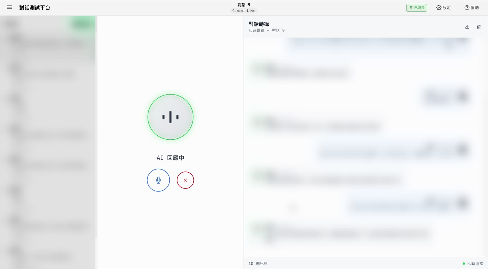

# 多模態即時語音 AI 對話平台 (Multimodal Realtime Voice Assistant Platform)

> **國泰人壽 GenAI 數據科學實習 — 智慧語音客服助理原型 (Cathay Life Insurance GenAI Voice Assistant Prototype)**  
> 一個基於 **React 18** 與 **TypeScript** 建構的專業多模態 AI 對話平台，採用**統一 Realtime API 架構**，整合 Google Gemini Live API 與 Azure OpenAI Realtime API，實現極低延遲的雙向即時語音對話與動態客服意圖路由。

---

## 🎬 實機演示 (Demo Showcase)


* **展示情境**：模擬保險公司 AI 客服專員，針對用戶「保費扣款失敗」事件進行多輪語音意圖辨識、確認換發信用卡情境，並動態引導線上補登流程。
* **錄影**：含內部對話內容，不公開，可另行提供。
* **完整介面截圖**：

<p align="center">
  
</p>

---

## 🎯 核心工程亮點 (Key Highlights)

### 1. 統一 Realtime API 架構 (`useUnifiedRealtime`)
* **跨廠商即時語音橋接**：抽象化底層 WebSocket 連線協議，單一介面即可無縫切換 **Google Gemini Live API**（極致低延遲雙向串流）與 **Azure OpenAI Realtime API**（企業級穩定度）。
* **完整狀態機**：統一管理連線中斷、音訊 Session 重啟、打斷偵測（Barge-in / Interruption handling）。

### 2. 高效能音訊處理架構 (Web Audio API & AudioWorklet)
* **自研 AudioStreamer 播放引擎**：解決瀏覽器音訊快取不連貫與卡頓問題，採用排程佇列維持音訊平滑輸出。
* **音量動態視覺化 (AudioPulse)**：藉由自定義 AudioWorklet (`vol-meter.ts`) 進行即時分貝運算，驅動流暢的綠色語音脈動波形。
* **AudioContext 生命週期安全守衛**：加入單例快取與狀態例外攔截，根除瀏覽器多次註冊造成的 `InvalidStateError`。

### 3. 動態 Prompt 配置與熱重載
* **可設定的 System Prompt**：角色與語氣在介面的設定面板調整（存在 Zustand store），不用重新編譯。實習期間使用的內部業務 prompt 不收錄在本 repo。

### 4. 企業級對話管理與資料持久化
* **多聊天室工作階段**：支援切換多個獨立對話工作階段。
* **IndexedDB 本地持久化**：完整保存多輪對話轉錄、時間戳記與連線日誌，支援歷史重播與重整後狀態復原。

---

## 🏗️ 系統架構分層

```text
src/
├── api/                 # API 客戶端層 (Gemini Live WebSocket / Azure Realtime WebSocket)
├── audio/               # 音訊處理核心 (Streamer 排程播放, Recorder, AudioWorklets)
├── hooks/               # React Custom Hooks (useLiveAPI, useUnifiedRealtime, useAudioStreamer)
├── stores/              # Zustand 狀態管理 (對話歷史, UI 狀態)
├── storage/             # IndexedDB 本地資料庫持久化層
├── utils/               # 音訊 Context 單例、Prompt 動態載入器、Message Factory
├── components/          # UI 元件 (AudioPulse 脈動波形, 側邊聊天室清單, 雙向轉錄面板)
└── App.tsx              # 應用程式主入口
```

---

## 🚀 快速開始 (Quick Start)

### 1. 環境需求
* Node.js 18+ 或 20+
* npm

### 2. 安裝依賴
```bash
npm install
```

### 3. 設定環境變數
複製範本檔案建立 `.env`：
```bash
cp .env.example .env
```
編輯 `.env` 並填入你的 Google Gemini API Key（可於 [Google AI Studio](https://aistudio.google.com/) 免費取得）：
```env
REACT_APP_GEMINI_API_KEY=AIzaSy...你的金鑰
```
*(若需測試 Azure Realtime API，請填入 Azure OpenAI 端點與 Key)*

### 4. 啟動開發伺服器
> [!NOTE]
> 瀏覽器需要麥克風授權，建議使用 HTTPS 模式啟動以確保瀏覽器 Web Audio 權限正常。

```bash
# 標準啟動
npm start

# 或 HTTPS 啟動 (建議)
npm run start-https
```
瀏覽器將開啟於 `https://localhost:3000`。

---

## 🧪 品質驗證與自動化測試

本專案具備完整的型別安全與單元測試防線：

```bash
# 1. TypeScript 型別檢查 (0 errors)
npm run type-check

# 2. 執行單元測試 (8 個 Test Suites / 25 項測試通過)
npm test

# 3. 生產環境打包測試
npm run build
```

---

## 📂 技術詳細規格

架構重點見上方各節；程式碼在 `src/`，依 `api/`、`audio/`、`hooks/`、`stores/` 分層。
